# windows_exporter – Architecture & Program Flow (Programmablaufpläne)

This document explains **how windows_exporter works internally**, component by component, and
then how all components work together. Every part has a flow chart in the style of a
*Programmablaufplan* (PAP, DIN 66001), drawn with Mermaid so it renders directly on GitHub.

Based on upstream `prometheus-community/windows_exporter` `main` @ `5d6cf52`
("cmd: add --scrape.stdout one-shot mode (#2705)").

---

## Table of contents

0. [How to read the diagrams (PAP legend)](#0-how-to-read-the-diagrams-pap-legend)
1. [Big picture](#1-big-picture)
2. [Repository map](#2-repository-map)
3. [Component: process start & Windows service detection](#3-component-process-start--windows-service-detection)
4. [Component: configuration (YAML file + CLI flags)](#4-component-configuration-yaml-file--cli-flags)
5. [Component: logging](#5-component-logging)
6. [Component: main `run()` – startup sequence](#6-component-main-run--startup-sequence)
7. [Component: collector selection & `Collection.Build`](#7-component-collector-selection--collectionbuild)
8. [Component: HTTP layer (`/metrics`, `/health`, pprof)](#8-component-http-layer-metrics-health-pprof)
9. [Component: the scrape engine (`collectAll` / `collectCollector`)](#9-component-the-scrape-engine-collectall--collectcollector)
10. [Component: collector lifecycle state machine](#10-component-collector-lifecycle-state-machine)
11. [Component: MI / WMI query layer (`internal/mi`)](#11-component-mi--wmi-query-layer-internalmi)
12. [Component: PDH performance counter layer (`internal/pdh`)](#12-component-pdh-performance-counter-layer-internalpdh)
13. [Component: native Win32 APIs (`internal/headers`) – ClusAPI example](#13-component-native-win32-apis-internalheaders--clusapi-example)
14. [Helper components: metriccache, recovery.Group, utils.Counter](#14-helper-components-metriccache-recoverygroup-utilscounter)
15. [Example collectors end to end](#15-example-collectors-end-to-end)
16. [Error classification: success / failed / timeout](#16-error-classification-success--failed--timeout)
17. [Shutdown](#17-shutdown)
18. [Everything together](#18-everything-together)
19. [Collector → data source matrix](#19-collector--data-source-matrix)
20. [Exporter self-metrics](#20-exporter-self-metrics)

---

## 0. How to read the diagrams (PAP legend)

| PAP symbol (DIN 66001) | Meaning | Mermaid shape used here |
|---|---|---|
| Oval / Grenzstelle | Start / End | `([ Start ])` – rounded stadium |
| Rechteck / Operation | Processing step | `[ step ]` |
| Raute / Verzweigung | Decision (yes/no) | `{ question? }` |
| Parallelogramm / Ein-/Ausgabe | Input / Output (HTTP, file, Windows API) | `[/ I/O /]` |
| Rechteck mit Doppelrand / Unterprogramm | Call of a sub-routine described in another chart | `[[ subroutine ]]` |
| Zylinder | External system / data store | `[( store )]` |

Arrows labelled **ja / yes** and **nein / no** leave decisions. Dashed boxes (`subgraph`) group
steps that run in parallel goroutines.

---

## 1. Big picture

windows_exporter is a single Go binary that runs on a Windows host (as a console program or
as a Windows service). It exposes an HTTP endpoint. Every time Prometheus requests
`/metrics`, the exporter asks each enabled **collector** to read data from Windows and
converts that data into Prometheus metrics.

Windows offers the data through several very different interfaces, so the exporter has one
low-level layer per interface:

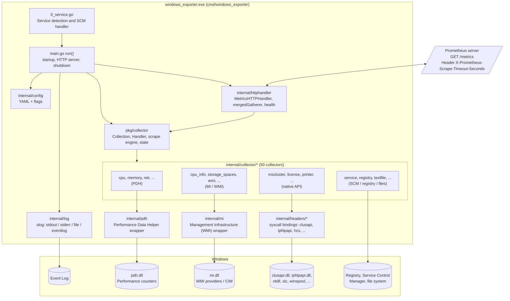

**Key ideas**

* **Two phases per collector:** `Build` (once, at startup – expensive preparation: open
  PDH queries, compile WMI queries, open cluster handles) and `Collect` (every scrape –
  cheap read + metric emission).
* **One scrape at a time** across the whole process (global `scrapeSlot`), but **all
  collectors of that scrape run in parallel**.
* **Every scrape has a deadline** derived from Prometheus' scrape timeout. A collector that
  is too slow is reported as *timed out* and its late metrics are thrown away – the HTTP
  response is never blocked longer than the deadline.
* **A single shared MI (WMI) session** is created in `Collection.Build` and passed to every
  collector.

---

## 2. Repository map

| Path | Responsibility |
|---|---|
| `cmd/windows_exporter/0_service.go` | Detects whether the process was started by the Service Control Manager (SCM) and talks to it. File name starts with `0_` so its package-level `var` runs first. |
| `cmd/windows_exporter/main.go` | `main()` and `run()`: flags, logger, collector build, HTTP server, `--scrape.stdout`, shutdown. |
| `internal/config` | Reads `--config.file` YAML, flattens it to flag names, injects values as flag defaults. |
| `internal/log` | Creates the `*slog.Logger` (promslog) writing to stdout/stderr/file/Windows Event Log. |
| `internal/httphandler` | `/metrics` handler (timeout calculation, per-request registry, `collect[]` filter), `/health`, merged gatherer. |
| `pkg/collector` | `Collection` (set of collectors), `Build`/`Close`, `Handler` (prometheus.Collector), scrape engine, per-collector state machine, self-metrics. Public so other programs (e.g. Grafana Alloy) can embed it. |
| `internal/collector/<name>` | One package per collector. Each implements `GetName`, `Build`, `Collect`, `Close`. |
| `internal/mi` | Pure-Go (no cgo) binding of `mi.dll`: Application, Session, async query with callbacks, struct unmarshalling via `mi:"..."` tags. |
| `internal/pdh` | Pure-Go binding of `pdh.dll`: query/counter handles, typed collectors via `perfdata:"..."` tags, shared queries. |
| `internal/headers/*` | Syscall bindings to other DLLs (ClusAPI, IP Helper, HCS, SLC, WinSpool, ...). |
| `internal/metriccache` | Reuse of immutable const-metrics between scrapes when input is unchanged. |
| `internal/utils/recovery` | `Run`/`Group`: goroutines whose panics become errors. |
| `internal/types` | Common constants (`windows` namespace) and sentinel errors (`ErrNoData`). |

---

## 3. Component: process start & Windows service detection

File: `cmd/windows_exporter/0_service.go`

The Windows SCM expects a service to report "running" within ~30 s. Go initialises
package-level variables before `init()` and before `main()`, and in file-name order, so the
variable `IsService` in `0_service.go` is evaluated **as the very first thing** in the
process.

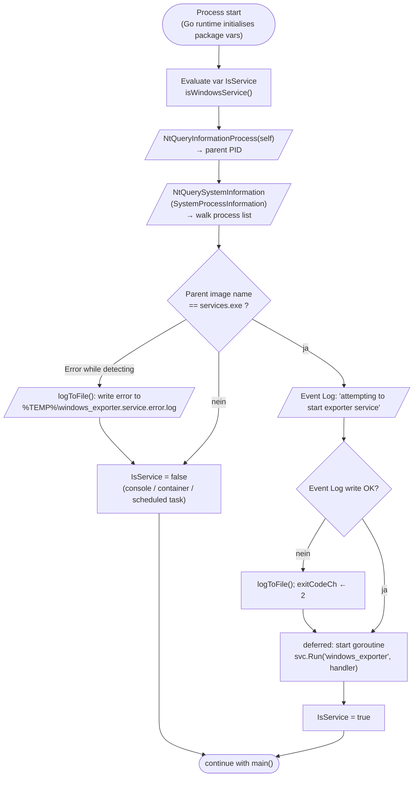

### Service control handler (`windowsExporterService.Execute`)

Runs in its own goroutine for the whole process lifetime when started as a service.

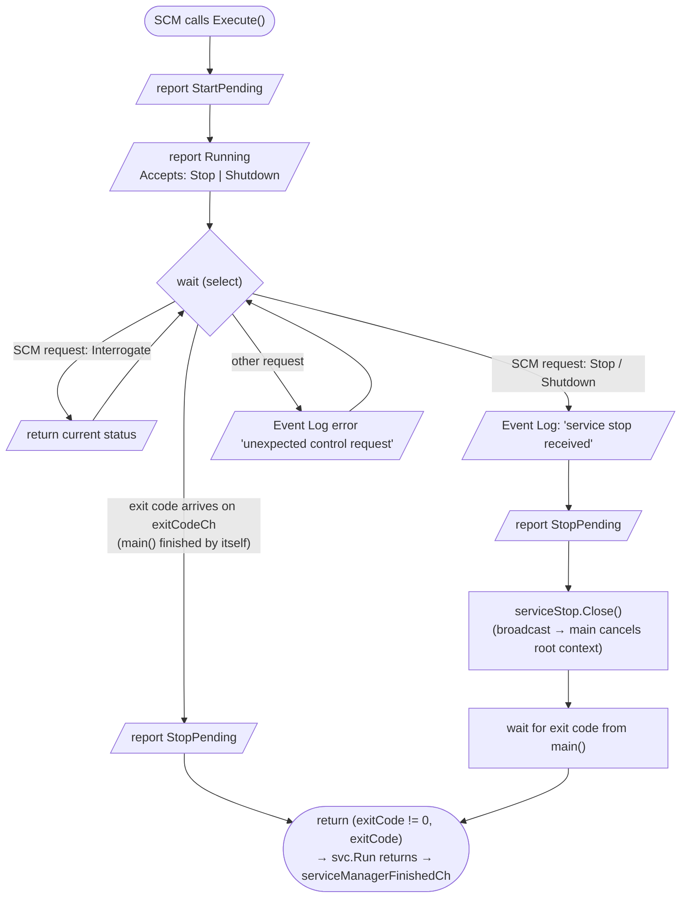

### `main()`

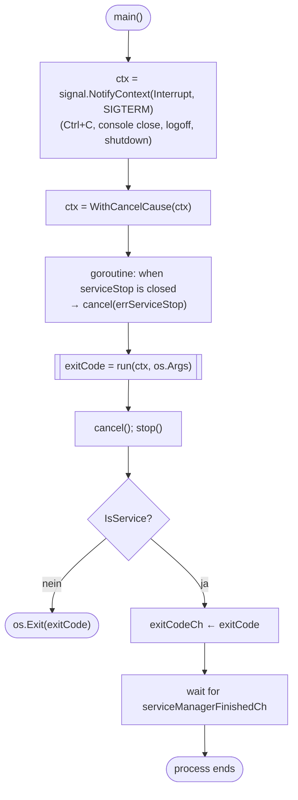

---

## 4. Component: configuration (YAML file + CLI flags)

Files: `internal/config/config.go`, `flatten.go`; every collector registers its own flags in
`NewWithFlags`.

Rule: **CLI flags override the YAML file**, YAML overrides built-in defaults. This works
because YAML values are installed as *flag defaults* before kingpin parses the command line.

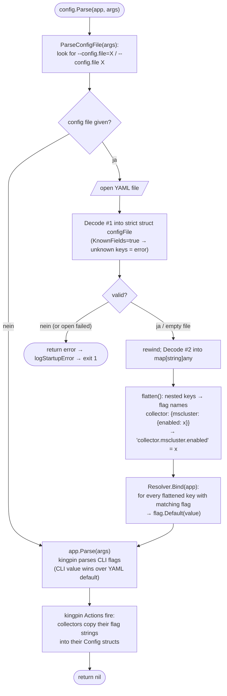

Example (`config.yaml` in the repo root):

```yaml
collectors:
  enabled: cpu,cpu_info,logical_disk,memory,net,os,process,service,system,textfile
collector:
  service:
    include: "windows_exporter"
log:
  level: warn
```

`collector.service.include` becomes the default of the flag `--collector.service.include`.

---

## 5. Component: logging

Files: `internal/log/logger.go`, `internal/log/flag/flag.go`, `internal/log/eventlog/`

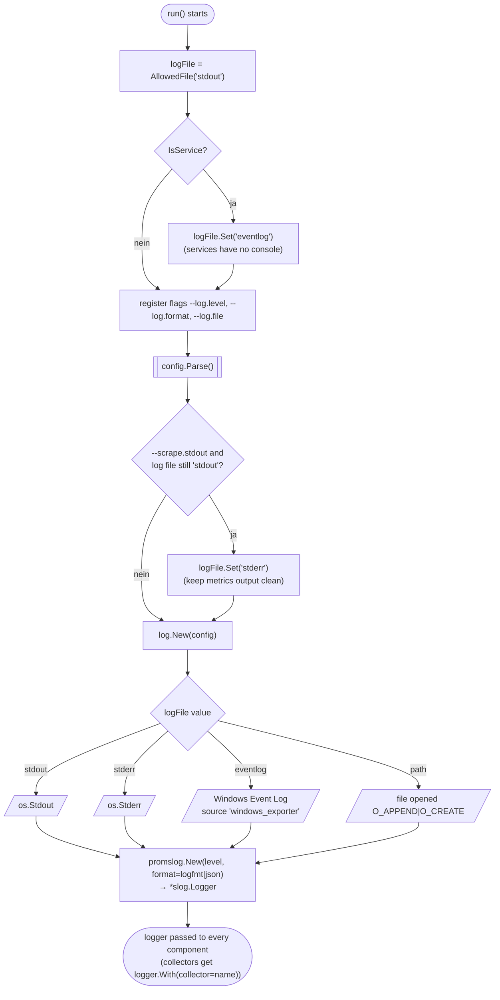

**Before the logger exists** (config error, invalid memory limit) `logStartupError` writes to
the default `slog` (stderr) and, for a service, also to the Event Log (or the temp file as a
last resort).

**What is logged where during a scrape**

| Situation | Level |
|---|---|
| Collector succeeded, number of metrics and duration | `debug` |
| Collector succeeded *with warnings* (expected "no data") | `debug` |
| Collector failed | `warn` |
| Collector timed out | `warn` |
| Collector skipped because last call still running | `warn` once, then `debug` |
| Scrape could not start because an earlier scrape still runs | `warn` |
| Collector build failed because feature not installed (`ErrUnsupported`, missing PDH object, missing WMI class/namespace, ...) | `warn` – exporter keeps running |
| Collector build failed for another reason | `error` – exporter exits with 1 |

---

## 6. Component: main `run()` – startup sequence

File: `cmd/windows_exporter/main.go`

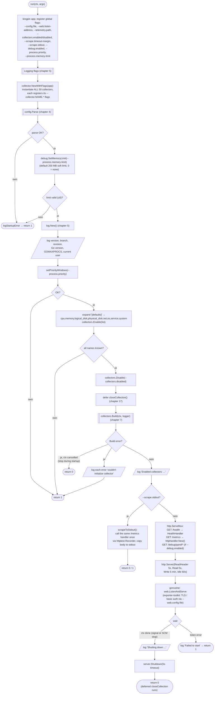

---

## 7. Component: collector selection & `Collection.Build`

Files: `pkg/collector/collection.go`, `pkg/collector/state.go`, `pkg/collector/map.go`

### 7.1 The collector interface

Every collector package implements:

```go
type Collector interface {
    GetName() string
    Build(logger *slog.Logger, miSession *mi.Session) error          // once
    Collect(ch chan<- prometheus.Metric, maxScrapeDuration time.Duration) error // per scrape
    Close() error                                                      // once at shutdown
}
```

### 7.2 `Collection.Build`

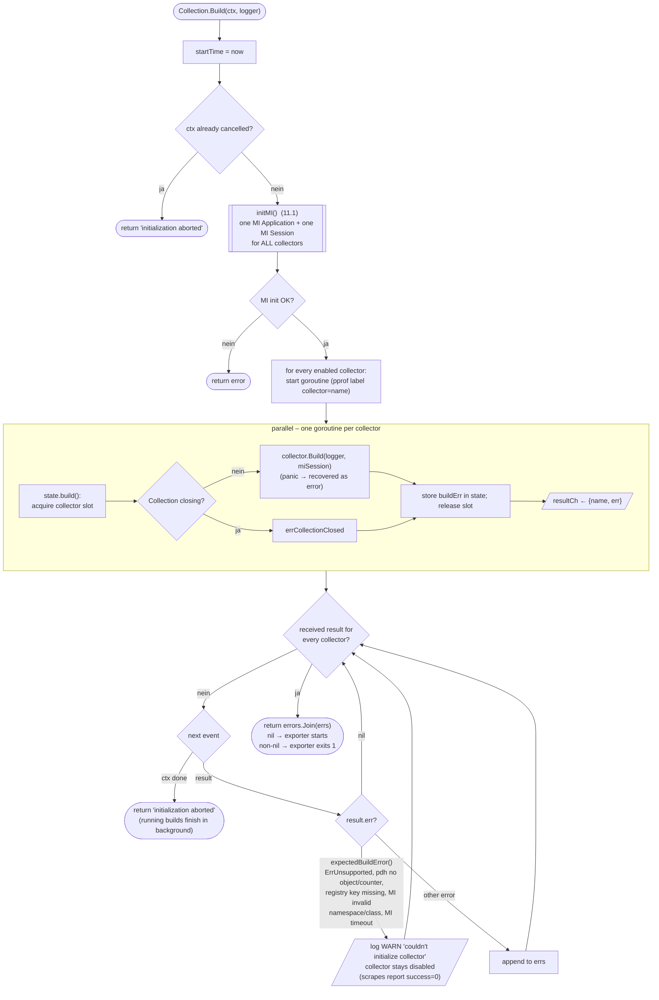

So a server without e.g. IIS installed can still have `iis` enabled: the collector logs a
warning and is skipped, the other collectors work.

### 7.3 Typical `Build` inside a collector

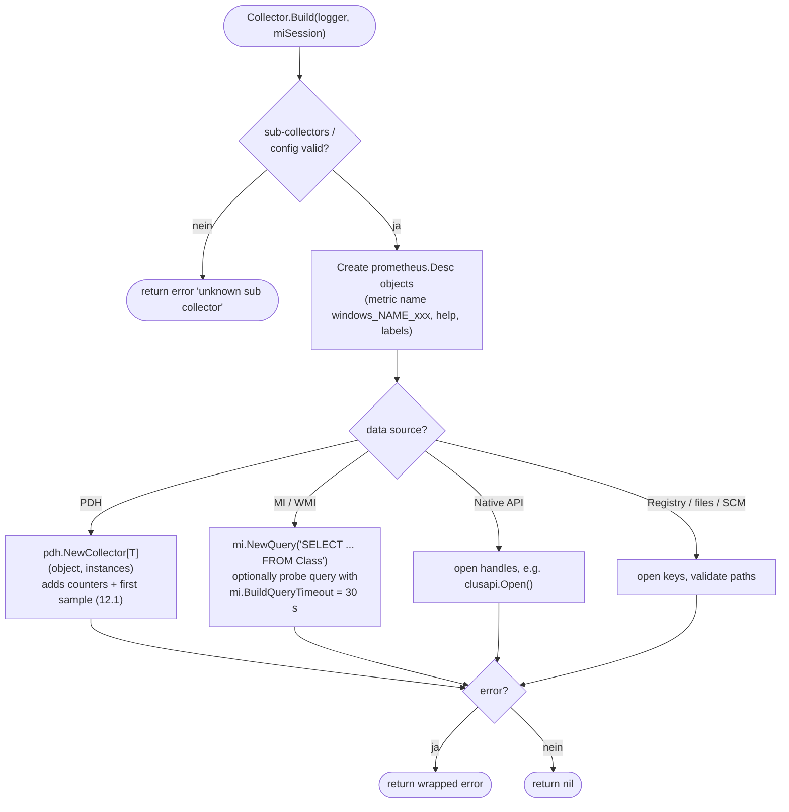

---

## 8. Component: HTTP layer (`/metrics`, `/health`, pprof)

Files: `internal/httphandler/httphandler.go`, `gatherer.go`, `health.go`

### 8.1 Request handling

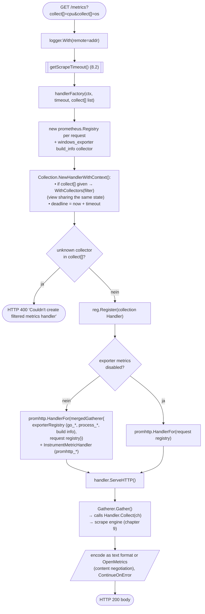

### 8.2 Scrape timeout calculation

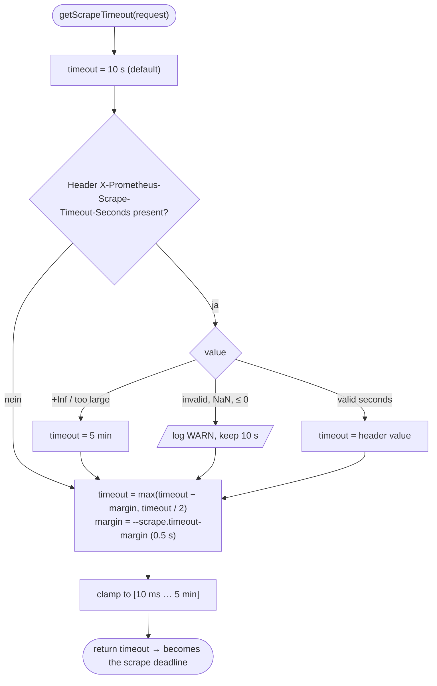

Example: Prometheus `scrape_timeout: 10s` → header `10` → collectors get **9.5 s**.

### 8.3 Merged gatherer

`mergedGatherer` gathers the exporter registry and the per-request registry, and – if no
metric family names collide – merges the two sorted lists directly (fast path). If names
could collide it falls back to `prometheus.Gatherers`, which does full consistency checks.

`GET /health` always returns `{"status":"ok"}` with HTTP 200 (liveness only, no collection).

---

## 9. Component: the scrape engine (`collectAll` / `collectCollector`)

Files: `pkg/collector/handler.go`, `pkg/collector/collect.go`

This is the heart of the exporter.

### 9.1 `Handler.Collect` → `collectAll`

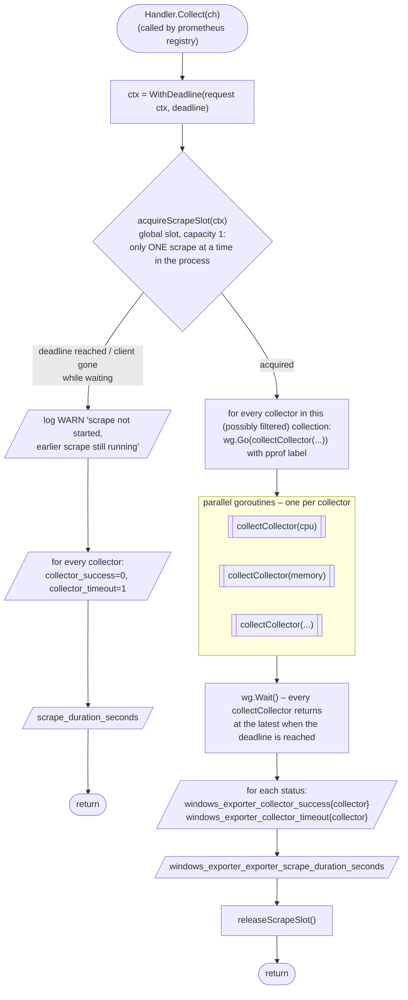

### 9.2 `collectCollector` – one collector inside one scrape

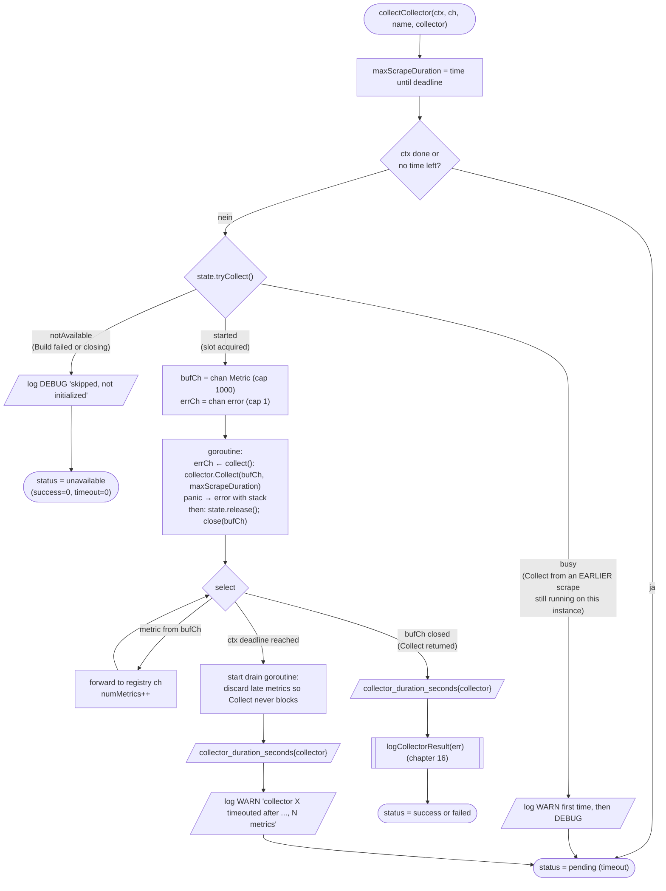

Important consequences:

* The registry channel `ch` is **only written by `collectCollector`**, never by the
  collector itself – that is why a timed-out collector cannot write into a closed channel.
* A collector that hangs (e.g. a stuck WMI provider) **keeps its slot**. In the next scrapes
  it is reported as `timeout=1` ("busy") **without starting a second call**, so hangs never
  pile up goroutines.
* `maxScrapeDuration` is handed to the collector so that it can pass it on as the MI query
  timeout or ClusAPI budget.

---

## 10. Component: collector lifecycle state machine

File: `pkg/collector/state.go`. Each collector has a `collectorState` with a one-element
channel `slot` (a mutex that can be tried without blocking) and flags.

```mermaid
stateDiagram-v2
    [*] --> Created: NewWithFlags / New
    Created --> Building: Collection.Build → state.build() takes slot
    Building --> BuildFailed: Build returned error / panic
    Building --> Idle: Build OK (slot released)
    Idle --> Collecting: tryCollect() = started (slot taken)
    Collecting --> Idle: Collect returned → release()
    Collecting --> Collecting: scrape deadline passed;<br/>next scrapes get "busy" (timeout=1)
    BuildFailed --> BuildFailed: tryCollect() = notAvailable (success=0)
    Idle --> Closed: Collection.Close → close() takes slot forever,<br/>Collector.Close()
    Collecting --> CloseWaiting: Close requested
    CloseWaiting --> Closed: Collect returned within 5 s
    CloseWaiting --> LeftOpen: still busy after 5 s<br/>(errCollectorBusy, MI session kept open)
    BuildFailed --> [*]
    Closed --> [*]
    LeftOpen --> [*]
```

---

## 11. Component: MI / WMI query layer (`internal/mi`)

MI (*Windows Management Infrastructure*, `mi.dll`) is the modern native API behind WMI/CIM.
The exporter calls it **without cgo**, through `syscall.SyscallN` on the function tables
(`ApplicationFT`, `SessionFT`, `OperationFT`, `InstanceFT`) that MI returns.

### 11.1 Initialisation – `Collection.initMI()`

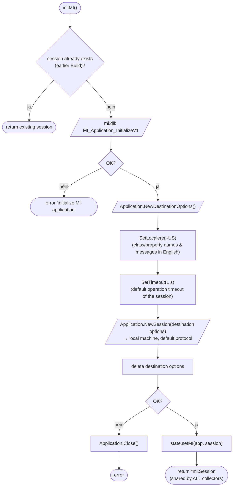

Predefined namespaces (`internal/mi/types.go`): `root/CIMv2`, `root/Microsoft/Windows/Storage`,
`root/virtualization/v2`, `root/MicrosoftDNS`, `root/WebAdministration`, `root/Microsoft/Windows/FSRM`,
`root/MSCluster` and more. Queries are compiled once in `Build` with `mi.NewQuery("SELECT ...")`
(converted to UTF-16) and the dialect is always WQL.

### 11.2 `Session.Query[T]` – the query flow used by collectors

A collector declares a struct whose fields carry `mi:"PropertyName"` tags, e.g.

```go
type msftVirtualDisk struct {
    FriendlyName    string `mi:"FriendlyName"`
    HealthStatus    uint16 `mi:"HealthStatus"`
    Size            uint64 `mi:"Size"`
}
var dst []msftVirtualDisk
err := c.miSession.Query(&dst, mi.NamespaceRootStorage, c.virtualDiskMIQuery, maxScrapeDuration)
```

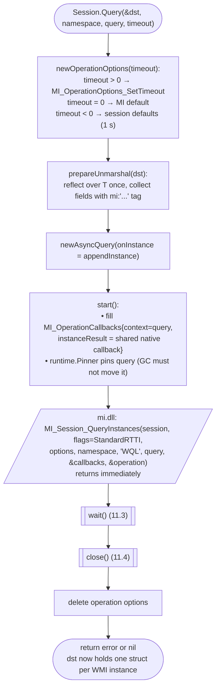

### 11.3 Callback side vs. waiting goroutine

MI delivers each result instance **on one of its own threads** by calling the native
callback. The callback must never block and must never call back into the operation.

```mermaid
flowchart TD
    subgraph MI_THREAD["MI worker thread – instanceResultCallback(context, instance, moreResults, resultCode, ...)"]
        CB0(["callback invoked"]) --> CB1["find asyncQuery from context; lock q.mu"]
        CB1 --> CB2{"resultCode == MI_RESULT_OK?"}
        CB2 -- "nein" --> CB3["first error wins:<br/>q.err = 'failed to get instance: ...'<br/>(timeout, invalid class/namespace, access denied ...)"]
        CB2 -- "ja" --> CB4{"q.err set or<br/>instance == nil?"}
        CB4 -- "ja" --> CB9
        CB4 -- "nein" --> CB5["onInstance(instance):<br/>Query: unmarshal properties → append T to dst<br/>QueryFunc: MI_Instance_Clone → pending queue,<br/>signal 'queued'"]
        CB5 --> CB6{"error / panic?"}
        CB6 -- "ja" --> CB7["fail(): q.err = err,<br/>send cancelRequested"]
        CB6 -- "nein" --> CB9
        CB3 --> CB9
        CB7 --> CB9["unlock q.mu"]
        CB9 --> CB10{"moreResults == false?"}
        CB10 -- "ja" --> CB11["close(q.done) (only once)"] --> CBX(["return to MI"])
        CB10 -- "nein" --> CBX
    end

    subgraph GO_THREAD["Calling goroutine – asyncQuery.wait()"]
        W0(["wait()"]) --> W1["start deadlock-guard timer<br/>(prevents Go runtime from declaring<br/>'all goroutines asleep', golang/go#55015)"]
        W1 --> W2{"select"}
        W2 -- "q.done" --> W3["handle remaining queued copies"] --> W4(["return handlerErr / q.err / nil"])
        W2 -- "cancelRequested" --> W5[/"MI_Operation_Cancel"/] --> W2
        W2 -- "queued (QueryFunc only)" --> W6["run user fn on copies,<br/>MI_Instance_Delete each copy"] --> W2
        W2 -- "guard timer tick" --> W7["reset timer"] --> W2
    end
```

### 11.4 `asyncQuery.close()`

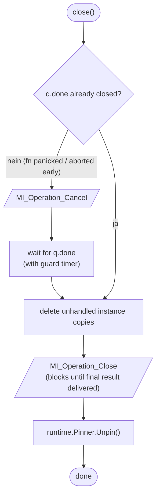

### 11.5 Unmarshalling MI values into Go fields

| MI type | Allowed Go field |
|---|---|
| `BOOLEAN` | `bool` |
| `UINT8/16/32/64` | any unsigned int that can hold the value (overflow → error) |
| `SINT8/16/32/64` | any int; unsigned field only if value ≥ 0 |
| `REAL32` | `float32`, `float64` |
| `REAL64` | `float64` |
| `STRING` | `string` (UTF-16 → UTF-8) |
| `CHAR16` | `string` (one rune) or unsigned int |
| `UINT16A` | `[]uint16` |
| `STRINGA` | `[]string` |
| `NULL` value | field left at zero value (type still checked) |

With `Query`/`QueryUnmarshal`, properties missing on the instance are skipped
(`MI_RESULT_NO_SUCH_PROPERTY`), so newer/older Windows versions with different MOF
definitions don't break the collector.

### 11.6 Why callbacks (design rationale from `internal/mi/AGENTS.md`)

* The synchronous `MI_Operation_GetInstance` loop leaks Event handles in the WMI client under
  parallel queries or slow providers (e.g. `MSFT_StoragePool`). The callback path avoids
  that.
* Native callbacks are created **once** (`sync.OnceValue`) – Windows allows only ~2000
  `windows.NewCallback`s per process and they are never freed.
* Panics in callbacks are recovered – they must never unwind into native MI code.

---

## 12. Component: PDH performance counter layer (`internal/pdh`)

PDH (*Performance Data Helper*, `pdh.dll`) is the API behind Performance Monitor
(`perfmon`). Counters are addressed by paths like `\Processor Information(*)\% Processor Time`.

A collector declares a struct with `perfdata:"Counter Name"` tags (float64 fields) and an
optional `Name` field for the instance name:

```go
type perfDataCounterValues struct {
    Name                  string
    C1TimeSeconds         float64 `perfdata:"% C1 Time"`
    IdleTimeSeconds       float64 `perfdata:"% Idle Time"`
    ProcessorUtilityRate  float64 `perfdata:"% Processor Utility"`
    ProcessorUtilityRateSecondValue float64 `perfdata:"% Processor Utility,secondvalue"`
}
```

### 12.1 `pdh.NewCollector[T]` (called in `Build`)

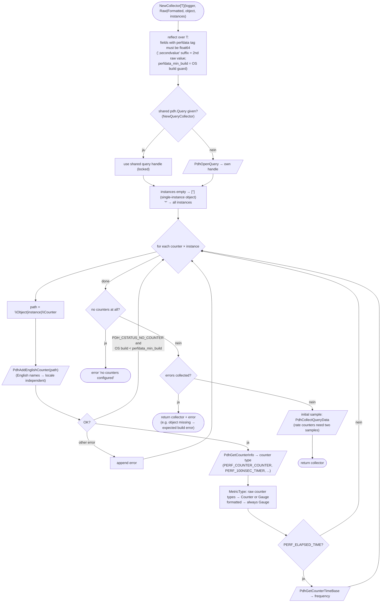

### 12.2 `Collector[T].Collect(&dst)` (called in every scrape)

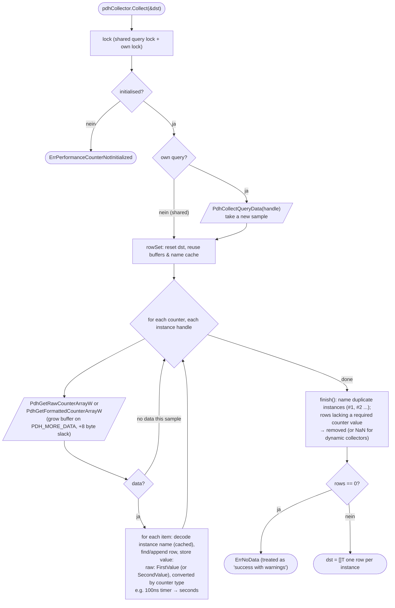

### 12.3 Shared PDH query (`pdh.Query`)

Windows serves counter samples for a process one at a time. Collectors that always read
together (e.g. IPv4 and IPv6 objects of TCP/UDP) are put into **one** `pdh.Query`:
`Query.Collect()` samples all of them with a single `PdhCollectQueryData`, then each
`Collector.Collect` only reads the arrays.

---

## 13. Component: native Win32 APIs (`internal/headers`) – ClusAPI example

Some data is not available (or too slow) through PDH or WMI. `internal/headers/*` contains
direct DLL bindings. The most complex user is **mscluster**, which upstream rewrote from
`root\MSCluster` WMI to **ClusAPI** (`clusapi.dll`).

```mermaid
flowchart TD
    S(["mscluster sub-collector Collect"]) --> D0{"source built?"}
    D0 -- "nein" --> X0(["error 'collector is not built'"])
    D0 -- "ja" --> CS[["callSource(budget, source.Read)"]]
    CS --> G["goroutine: read(deadline)<br/>(recover panics)"]
    G --> CA[/"ClusAPI RPCs: ClusterOpenEnum, OpenClusterNodeEx,<br/>ClusterNodeControl(CLUSCTL_*_GET_RO_COMMON_PROPERTIES), ...<br/>parse property lists from reused control buffer"/]
    CS --> W{"select"}
    W -- "result arrives" --> PUB["publish metrics<br/>(metriccache: reuse unchanged objects)"]
    W -- "budget (= maxScrapeDuration) expires" --> TO["return context.DeadlineExceeded<br/>RPC keeps running in background;<br/>source answers clusapi.ErrBusy until it returns;<br/>late result is dropped"]
    PUB --> X1(["return nil"])
    TO --> X2(["return error"])
```

mscluster's `Collect` runs its sub-collectors in a `recovery.Group`:

```mermaid
flowchart LR
    S(["mscluster.Collect"]) --> LK["lifecycleMu.Lock"]
    LK --> G{{"recovery.Group"}}
    G --> A["cluster"]
    G --> B["network"]
    G --> C["node → nodeNames"]
    C --> C1["resource (remaining budget, nodeNames)"]
    C --> C2["resourcegroup (remaining budget, nodeNames)"]
    G --> D["shared_volumes"]
    A & B & C1 & C2 & D --> WAIT["g.Wait() → errors.Join"]
    WAIT --> E(["return"])
```

Other native APIs: `iphlpapi` (TCP connection states), `hcs`/`hcn` (containers),
`slc` (license), `winspool` (printers), `wtsapi32` (RDP sessions), `fveapi` (BitLocker),
`sysinfoapi`/`ntdll` (memory, OS info), `cfgmgr32`/`gdi32` (GPU), `dhcpsapi` (DHCP).

---

## 14. Helper components: metriccache, recovery.Group, utils.Counter

### 14.1 `internal/metriccache`

Building a const metric allocates label pairs; collectors that publish many state-set series
per object (mscluster) reuse them when the input did not change.

```mermaid
flowchart TD
    S(["scrape := cache.Begin()"]) --> O{"for each object"}
    O --> K["key = object id,<br/>value = comparable struct of ALL inputs"]
    K --> L{"scrape.Load(key, value):<br/>previous generation has<br/>same key AND equal value?"}
    L -- "ja" --> R["reuse []prometheus.Metric"]
    L -- "nein" --> B["build new metrics; scrape.Store(key, value, metrics)"]
    R & B --> SEND[/"send metrics to ch"/] --> O
    O -- "done" --> C["scrape.Commit():<br/>new generation replaces old<br/>(skipped if cache.Reset() happened meanwhile)"]
    C --> X(["end"])
```

### 14.2 `internal/utils/recovery`

`recovery.Run(fn)` and `recovery.Group.Go(fn)` turn panics in goroutines into errors
(wrapping `recovery.ErrPanic` with stack trace) – a panic in one sub-collector cannot crash
the exporter.

### 14.3 `internal/utils.Counter`

Wraps a 32-bit raw value that can overflow (e.g. CPU `% Processor Utility` second value) and
accumulates it into a monotonically increasing 64-bit counter across scrapes.

---

## 15. Example collectors end to end

### 15.1 `cpu` – PDH based (default collector)

```mermaid
flowchart TD
    subgraph BUILD["Build (once)"]
        B1(["Build"]) --> B2["create 14 Desc: windows_cpu_time_total,<br/>cstate_seconds_total, interrupts_total, ..."]
        B2 --> B3[["pdh.NewCollector[perfDataCounterValues](Raw,<br/>'Processor Information', ['*'])"]]
        B3 --> B4(["ok"])
    end
    subgraph COLLECT["Collect (each scrape)"]
        C1(["Collect(ch)"]) --> C2["lock (maps of RTC/MPerf counters)"]
        C2 --> C3[["perfDataCollector.Collect(&rows)"]]
        C3 --> D{"error?"}
        D -- "ja" --> CX(["return error"])
        D -- "nein" --> C4{"for each row (core '0,0', '0,1', ...)"}
        C4 --> C5["update overflow-safe counters (utils.Counter)<br/>for ProcessorUtility / Performance 2nd values"]
        C5 --> C6[/"emit windows_cpu_cstate_seconds_total{core,state=c1|c2|c3}<br/>windows_cpu_time_total{core,mode=idle|user|privileged|dpc|interrupt}<br/>interrupts, dpcs, parking, frequency, utility ..."/]
        C6 --> C4
        C4 -- "done" --> C7[/"windows_cpu_logical_processor = row count"/] --> C8(["return nil"])
    end
```

### 15.2 `storage_spaces` – MI / WMI based

```mermaid
flowchart TD
    subgraph BUILD["Build"]
        B1(["Build(logger, miSession)"]) --> B2{"sub-collectors in<br/>{pool, virtual_disk}?"}
        B2 -- "nein" --> BX(["error unknown sub collector"])
        B2 -- "ja" --> B3{"miSession != nil?"}
        B3 -- "nein" --> BX2(["error"])
        B3 -- "ja" --> B4["mi.NewQuery('SELECT ... FROM MSFT_VirtualDisk')<br/>and 'SELECT ... FROM MSFT_StoragePool'"]
        B4 --> B5[/"probe: miSession.Query(..., root/Microsoft/Windows/Storage,<br/>BuildQueryTimeout 30 s)<br/>invalid namespace/class → expected build error"/]
        B5 --> B6(["ok"])
    end
    subgraph COLLECT["Collect"]
        C1(["Collect(ch, maxScrapeDuration)"]) --> G{{"recovery.Group"}}
        G --> P["collectStoragePool"]
        G --> V["collectVirtualDisk"]
        V --> V1[["miSession.Query(&dst, NamespaceRootStorage,<br/>query, timeout = maxScrapeDuration)  (11.2)"]]
        V1 --> V2{"for each MSFT_VirtualDisk"}
        V2 --> V3[/"windows_storage_spaces_virtual_disk_info / health_status /<br/>size_bytes / allocated_size_bytes / footprint_on_pool_bytes<br/>storage_efficiency_percent (only if footprint > 0)"/] --> V2
        P & V2 --> W["g.Wait()"] --> CX(["return errors.Join"])
    end
```

### 15.3 `textfile` – files

Reads `*.prom` files from `--collector.textfile.directories` (default
`<exe dir>\textfile_inputs`), parses them with the Prometheus text parser (BOM and `\r`
stripped), rejects duplicate series, converts families to const metrics and emits
`windows_textfile_mtime_seconds{file}`. A file that fails to parse (or a duplicate series) is skipped and reported as an error, so `collector_success{collector="textfile"}` becomes 0 while the other files are still exported.

### 15.4 `service` – Service Control Manager

Opens the SCM, enumerates services (filtered by `--collector.service.include/exclude`
regexes) and emits `windows_service_state{name,state}`, `windows_service_info`,
`windows_service_start_mode`, `windows_service_process` (PID). Service config is cached from the registry (`HKLM\SYSTEM\CurrentControlSet\Services`).

---

## 16. Error classification: success / failed / timeout

```mermaid
flowchart TD
    S(["Collect returned err"]) --> D0{"err == nil?"}
    D0 -- "ja" --> OK[/"log DEBUG 'collector X succeeded after D, N metrics'"/] --> SUC(["success=1, timeout=0"])
    D0 -- "nein" --> D1{"expectedCollectionError(err)?<br/>EVERY cause is one of:<br/>pdh.ErrNoData, types.ErrNoData,<br/>EPT_S_NOT_REGISTERED (RPC endpoint missing)"}
    D1 -- "ja" --> W[/"log DEBUG 'succeeded with warnings' + err"/] --> SUC
    D1 -- "nein" --> D2{"ErrPerformanceCounterNotInitialized?"}
    D2 -- "ja" --> H["append hint 'check logs from initialization phase'"] --> F
    D2 -- "nein" --> F[/"log WARN 'collector X failed after D, N metrics' + err"/]
    F --> FAIL(["success=0, timeout=0<br/>(metrics sent before the error are still exposed)"])
```

| Outcome | `collector_success` | `collector_timeout` |
|---|---|---|
| success / success with warnings | 1 | 0 |
| failed | 0 | 0 |
| timed out, busy from earlier scrape, or scrape slot not acquired | 0 | 1 |
| unavailable (Build failed / closed) | 0 | 0 |

---

## 17. Shutdown

```mermaid
flowchart TD
    S(["Ctrl+C / SIGTERM / SCM Stop"]) --> C["root ctx cancelled<br/>(cause errServiceStop for SCM)"]
    C --> D{"phase?"}
    D -- "still in Collection.Build" --> B["Build returns 'aborted'; run returns 0"] --> CC
    D -- "serving HTTP" --> L[/"log 'Shutting down windows_exporter via ...'"/]
    L --> SH["server.Shutdown(5 s):<br/>stop accepting, wait for in-flight requests"]
    SH --> CC[["deferred closeCollection()"]]
    CC --> G["goroutine: Collection.Close()"]
    G --> F{"for each collector"}
    F --> F1{"built and not closed?"}
    F1 -- "nein" --> F
    F1 -- "ja" --> F2{"slot free within 5 s?"}
    F2 -- "nein" --> F3["errCollectorBusy – leave it open"] --> F
    F2 -- "ja" --> F4["keep slot forever (no more Build/Collect)<br/>Collector.Close(): free PDH queries,<br/>ClusAPI handles, ..."] --> F
    F -- "done" --> M{"any collector busy?"}
    M -- "ja" --> M1["keep MI session open<br/>(closing would break running ops)"]
    M -- "nein" --> M2[/"MI_Session_Close, MI_Application_Close"/]
    M1 & M2 --> T{"finished within 10 s?"}
    T -- "nein" --> TW[/"log WARN 'collectors didn't close within 10s'"/]
    T -- "ja" --> E
    TW --> E["return exit code to main()"]
    E --> SVC{"service?"}
    SVC -- "ja" --> SV["exitCodeCh → Execute returns → SCM 'Stopped'"]
    SVC -- "nein" --> EX(["os.Exit"])
    SV --> EX2(["process ends"])
```

---

## 18. Everything together

### 18.1 Complete lifecycle (overview PAP)

```mermaid
flowchart TD
    A(["windows_exporter.exe starts"]) --> B[["Service detection (3)"]]
    B --> C[["Flags + YAML config (4)"]]
    C --> D[["Logger (5)"]]
    D --> E["Priority, memory limit, enable/disable collectors (6)"]
    E --> F[["Collection.Build: MI session + parallel collector Build (7)"]]
    F --> G{"fatal build errors?"}
    G -- "ja" --> Z1(["exit 1"])
    G -- "nein" --> H{"--scrape.stdout?"}
    H -- "ja" --> I[["one scrape → stdout"]] --> Z2(["exit"])
    H -- "nein" --> J[/"HTTP server listening :9182"/]
    J --> K{"event"}
    K -- "GET /metrics" --> L[["HTTP handler (8) → scrape engine (9)<br/>→ collectors → PDH (12) / MI (11) / API (13)"]]
    L --> M[/"metrics response"/] --> K
    K -- "GET /health" --> N[/"200 ok"/] --> K
    K -- "stop signal / SCM stop" --> O[["Shutdown (17)"]]
    O --> Z3(["exit 0"])
```

### 18.2 One scrape across all layers (sequence)

```mermaid
sequenceDiagram
    autonumber
    participant P as Prometheus
    participant H as MetricsHTTPHandler
    participant R as prometheus.Registry<br/>(per request)
    participant CH as collector.Handler
    participant E as Scrape engine<br/>collectAll
    participant CPU as cpu collector
    participant SS as storage_spaces collector
    participant PDH as internal/pdh → pdh.dll
    participant MI as internal/mi → mi.dll

    P->>H: GET /metrics (X-Prometheus-Scrape-Timeout-Seconds: 10)
    H->>H: timeout = 9.5 s, deadline = now + 9.5 s
    H->>R: new Registry, register build_info + CH
    H->>R: promhttp Gather()
    R->>CH: Collect(ch)
    CH->>E: collectAll(ctx with deadline)
    E->>E: acquire global scrapeSlot
    par cpu
        E->>CPU: Collect(bufCh, 9.5 s) [own goroutine]
        CPU->>PDH: perfDataCollector.Collect(&rows)
        PDH->>PDH: PdhCollectQueryData + PdhGetRawCounterArrayW
        PDH-->>CPU: rows per core
        CPU-->>E: metrics via bufCh → forwarded to ch
    and storage_spaces
        E->>SS: Collect(bufCh, 9.5 s) [own goroutine]
        SS->>MI: Session.Query(MSFT_VirtualDisk, timeout 9.5 s)
        MI-->>MI: MI_Session_QueryInstances (async)
        MI-->>SS: callbacks on MI threads → unmarshalled []struct
        SS-->>E: metrics via bufCh → forwarded to ch
    end
    E->>E: wait all (or deadline) → collector_success / timeout / duration
    E->>E: scrape_duration_seconds, release scrapeSlot
    CH-->>R: done
    R-->>H: metric families (merged with go_*, process_*)
    H-->>P: 200 text/plain or OpenMetrics
```

### 18.3 Concurrency model at a glance

```mermaid
flowchart TB
    subgraph PROC["Process"]
        SL["global scrapeSlot (cap 1)<br/>→ max. 1 scrape at a time"]
        subgraph SCRAPE["one scrape"]
            direction LR
            CC1["collectCollector cpu"] --> W1["Collect goroutine<br/>(holds cpu slot)"]
            CC2["collectCollector os"] --> W2["Collect goroutine<br/>(holds os slot)"]
            CC3["collectCollector mscluster"] --> W3["Collect goroutine"] --> G3{{"recovery.Group<br/>sub-collectors"}} --> RPC["callSource goroutines<br/>(ClusAPI RPC)"]
        end
        MIS[("ONE shared MI session")]
        W2 -. "WMI queries" .-> MIS
    end
    SL --> SCRAPE
```

* Concurrency **between** scrapes: none (global slot).
* Concurrency **inside** a scrape: all collectors in parallel; many collectors run their
  sub-collectors in parallel again (`recovery.Group`).
* A collector instance never runs `Collect` twice at the same time (per-collector slot).
* `collect[]` filtered requests use **views** (`WithCollectors`) that share the same state,
  so the guarantees hold for filtered and unfiltered requests together.

---

## 19. Collector → data source matrix

Determined from the imports/calls in each package (upstream `main`).
**PDH** = performance counters, **MI** = WMI via `mi.dll`, **API** = DLL bindings in
`internal/headers`, **REG** = registry, **win32** = `golang.org/x/sys/windows` calls (SCM,
NtQuery*, file APIs, ...), **COM** = OLE automation.

| Collector | Default | PDH | MI (WMI) | Native API / other |
|---|:-:|:-:|:-:|---|
| ad, adcs, adfs, cache, dfsr, exchange, msmq, nps, remote_fx, smb, smbclient, smtp, udp, vmware, physical_disk, performancecounter | physical_disk ✓ | ✓ | | |
| cpu | ✓ | ✓ | | |
| memory | ✓ | ✓ | | sysinfoapi (GlobalMemoryStatusEx) |
| logical_disk | ✓ | ✓ | | kernel32 volume APIs, fveapi (BitLocker) |
| net | ✓ | ✓ | | GetAdaptersAddresses (win32) |
| os | ✓ | | | sysinfoapi, registry |
| service | ✓ | | | SCM (win32), registry |
| system | ✓ | ✓ | | ntdll |
| cpu_info, diskdrive, fsrmquota, storage_spaces, wmi | | | ✓ | |
| dns | | ✓ | ✓ | |
| process | | | ✓ (IIS app pools) | NtQuerySystemInformation |
| hyperv | | ✓ | ✓ | hcs, virtdisk, sysinfoapi |
| mscluster | | | | **clusapi** (all sub-collectors native since upstream #2634) |
| iis, mssql | | ✓ | | registry |
| dhcp | | ✓ | | dhcpsapi |
| gpu | | ✓ | | cfgmgr32, gdi32 |
| pagefile | | ✓ | | psapi |
| tcp | | ✓ | | iphlpapi |
| terminal_services | | ✓ | | wtsapi32 |
| time | | ✓ | | kernel32, registry |
| container | | | | hcs, hcn, cri |
| dmi | | | | sysinfoapi (SMBIOS) |
| license | | | | slc |
| printer | | | | winspool |
| file | | | | win32 file APIs |
| registry | | | | registry |
| scheduled_task, update | | | | COM (internal/ole) |
| textfile | | | | `*.prom` files |

---

## 20. Exporter self-metrics

| Metric | Source | Meaning |
|---|---|---|
| `windows_exporter_collector_success{collector}` | scrape engine | 1 if the collector ran successfully in this scrape |
| `windows_exporter_collector_timeout{collector}` | scrape engine | 1 if the collector timed out / was busy / scrape slot not acquired |
| `windows_exporter_collector_duration_seconds{collector}` | scrape engine | wall time of that collector in this scrape |
| `windows_exporter_exporter_scrape_duration_seconds` | scrape engine | wall time of the whole scrape |
| `windows_exporter_build_info{version,revision,...}` | `version.NewCollector` | build information |
| `go_*`, `process_*`, `promhttp_*` | exporter registry | Go runtime, process and HTTP handler stats (disable with `--web.disable-exporter-metrics`) |

Useful alert: `windows_exporter_collector_success == 0 or windows_exporter_collector_timeout == 1`.
